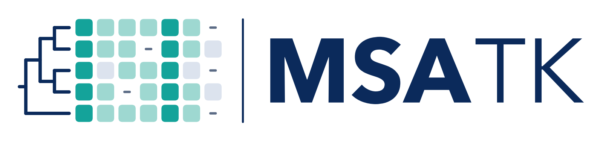

# MSATK



MSATK is a unified framework for **statistical profiling, visualization and
machine-learning representations of multiple sequence alignments**.

```bash
pip install "msatk[plots]"
msatk profile alignment.fasta
```

One command produces:

* explicitly defined statistics at alignment, sequence, site and pair resolution
  ([conventions](statistics.md), [metric dictionary](metrics.md));
* severity-ranked [QC findings](qc_warnings.md);
* publication-quality figures, alignment views and logos ([visualization](visualization.md));
* an interactive, fully offline `report.html`;
* optional reproducible tensors and images for ML ([ML encodings](ml_encodings.md));
* complete provenance (input hash, versions, parameters).
