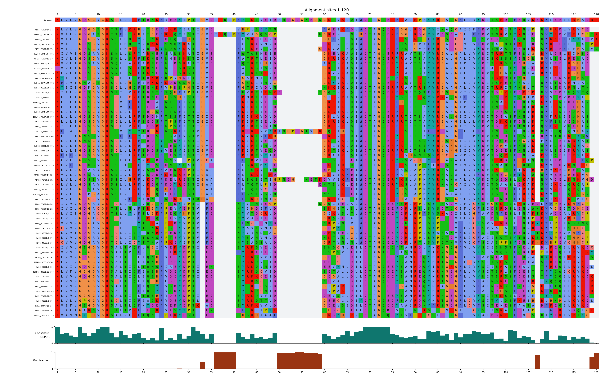

<!-- Generated by docs/tutorials/build.py from _src/01_quickstart.md; edit the template. -->

# 1. Profile an alignment in one command

**You will:** profile a real protein-family alignment from the command line, read the
summary, look at the QC findings and open the interactive report.

**Data:** the Ras-family seed alignment from Pfam (PF00071; 60 sequences, 229 columns),
bundled with MSATK.

## Get the data

`msatk datasets` lists the bundled tutorial datasets and copies them to a folder.

```bash
msatk datasets ras_pf00071 --out data
```

```text
data/ras_pf00071.sto.gz
```

Compressed input (`.gz`) is read directly, so there is no need to unpack it.

## Check what the file is

`msatk inspect` reports the format, the data model, what the file contains and which
analyses apply, before any computation.

```bash
msatk inspect data/ras_pf00071.sto.gz
```

```text

data/ras_pf00071.sto.gz
  format:        Stockholm (stockholm, stable)
  compressed:    gzip
  data model:    SequenceAlignment (kind: sequence)
  molecule_type: protein
  scope:         multiple
  method:        unknown
  sequences:     60
  columns:       229
  annotations:   GC:seq_cons

  valid analyses:
    - alignment/site/sequence/pair statistics
    - QC findings
    - alignment figures, logos, HTML report, ML encodings
    - amino-acid composition, physicochemical and BLOSUM62 scores

  specialized analyses for this input:
    - pairwise_alignment: skipped: 60 sequences (needs exactly 2)
    - substitution: run: protein alignment (BLOSUM62)
    - rna_structure: skipped: no consensus structure (Stockholm #=GC SS_cons)
    - profile_states: skipped: no match/insert state annotation (A2M/A3M or #=GC RF)
    - partitions: skipped: no partitions (NEXUS charsets or --partitions file)

  status: readable
```

## Profile it

```bash
msatk profile data/ras_pf00071.sto.gz --out ras_profile --plots png --self-contained
```

```text

MSATK alignment profile complete

Input: data/ras_pf00071.sto.gz
Detected type: protein
Sequences: 60
Alignment length: 229
Gap fraction: 27.7%
Variable sites: 184
Mean pairwise identity: 37.8% (exact)

Summary interpretation:
This protein alignment contains 60 sequences and 229 sites, with 184 variable sites and mean pairwise identity of 37.8%. Overall missingness is moderate at 27.7%, so flagged sequences and high-gap sites should be reviewed before downstream analysis. MSATK generated 3 warning(s) that should be inspected.

Warnings:
- 67 alignment columns have >50% gaps.
- 26 sequences have unusually low identity to the consensus.
- 1 sequences have >30% gaps.

Results written to:
ras_profile/
Open report:
ras_profile/report.html
```

The output directory has a fixed structure:

```python
from pathlib import Path

for path in sorted(Path("ras_profile").rglob("*")):
    if path.is_file() and path.parent.name != "assets":
        print(path)
```

```text
ras_profile/figures/alignment_overview.png
ras_profile/figures/composition_summary.png
ras_profile/figures/conservation_by_site.png
ras_profile/figures/entropy_by_site.png
ras_profile/figures/gap_fraction_by_site.png
ras_profile/figures/missingness_by_sequence.png
ras_profile/figures/pairwise_distance_distribution.png
ras_profile/figures/pairwise_identity_distribution.png
ras_profile/figures/pairwise_identity_heatmap.png
ras_profile/figures/sequence_logo.png
ras_profile/metric_dictionary.json
ras_profile/msatk.log
ras_profile/parameters.yaml
ras_profile/qc_findings.json
ras_profile/qc_warnings.txt
ras_profile/report.html
ras_profile/report.md
ras_profile/run_manifest.json
ras_profile/summary.json
ras_profile/tables/alignment_summary.csv
ras_profile/tables/amino_acid_summary.csv
ras_profile/tables/composition_summary.csv
ras_profile/tables/distance_matrix.csv
ras_profile/tables/entropy_by_site.csv
ras_profile/tables/gap_blocks.csv
ras_profile/tables/hydrophobicity_summary.csv
ras_profile/tables/pairwise_comparisons.csv
ras_profile/tables/pairwise_identity_matrix.csv
ras_profile/tables/per_sequence_stats.csv
ras_profile/tables/per_site_stats.csv
ras_profile/tables/qc_findings.csv
ras_profile/tables/qc_flags.csv
ras_profile/tables/residue_class_summary.csv
ras_profile/tables/site_substitution_scores.csv
```

## Read the summary

`summary.json` holds the alignment-level statistics and their provenance. Every field is
defined in `metric_dictionary.json`, which is written alongside it.

```python
import json

summary = json.loads(Path("ras_profile/summary.json").read_text())
for key in ["molecule_type", "number_of_sequences", "alignment_length", "gap_fraction",
            "variable_sites", "parsimony_informative_sites", "mean_pairwise_identity",
            "pairwise_method"]:
    print(f"{key:30} {summary[key]}")
```

```text
molecule_type                  protein
number_of_sequences            60
alignment_length               229
gap_fraction                   0.2771470160116448
variable_sites                 184
parsimony_informative_sites    160
mean_pairwise_identity         0.3775823268225725
pairwise_method                exact
```

Statistics that cannot be computed are reported as `null`, never as 0. For example, a
column that contains only gaps is classed as *unobserved* and has no entropy.

## QC findings

QC findings are ranked by severity. Each one says which sequences or sites are affected
and what to do about it.

```python
findings = json.loads(Path("ras_profile/qc_findings.json").read_text())
for f in findings:
    print(f"[{f['severity']:7}] {f['code']:22} n={f['count']:<3} {f['message']}")
    if f["suggestion"]:
        print(f"{'':12}-> {f['suggestion']}")
```

```text
[warning] HIGH_GAP_SITES         n=67  67 alignment columns have >50% gaps.
            -> Consider trimming gap-rich columns (e.g. trimAl, ClipKIT) before tree inference.
[warning] DIVERGENT_SEQUENCES    n=26  26 sequences have unusually low identity to the consensus.
            -> Check for misalignment, contamination, paralogy or reverse-complemented input.
[warning] HIGH_GAP_SEQUENCES     n=1   1 sequences have >30% gaps.
            -> Inspect partial or fragmentary sequences; consider removing them.
```

Pfam seed alignments contain insert-state columns that only a few sequences fill, so
`HIGH_GAP_SITES` is expected here.

## The interactive report

Open `ras_profile/report.html` in a browser. It works offline, and with
`--self-contained` it is a single file you can share. It includes:

- a residue viewer with scrolling, zoom, search and difference highlighting;
- site tracks you can click;
- sortable tables you can export as CSV;
- a pairwise identity heatmap, the QC findings, provenance and the metric dictionary.

Static figures are written alongside the report:



## Next

- [Tutorial 2](02_statistics_python.md) works with the same statistics from Python.
- `msatk profile --help` lists the presets. `basic` skips pairwise comparison; `comprehensive` adds exact pairwise identity, embeddings and ML tensors.
