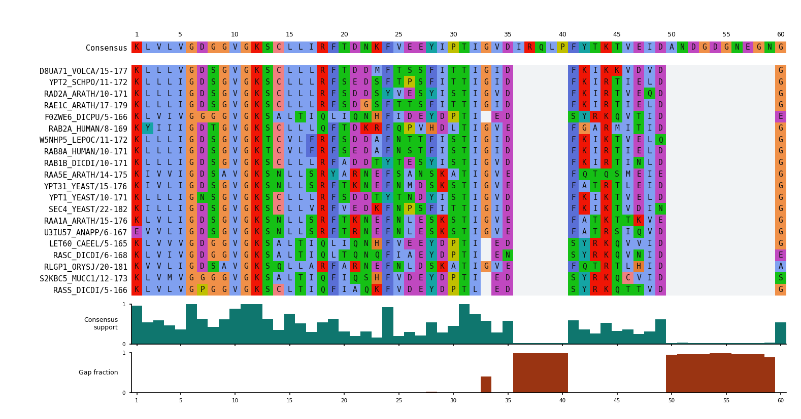
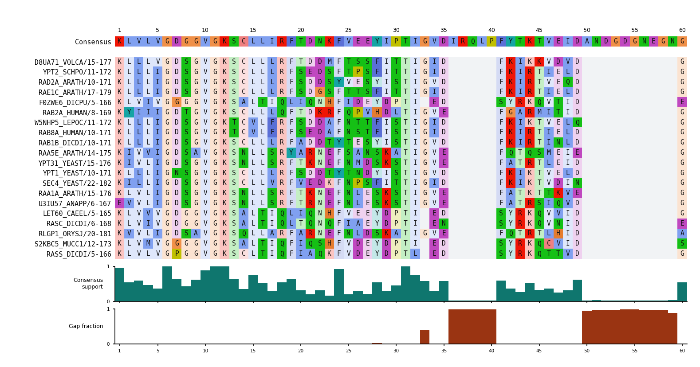
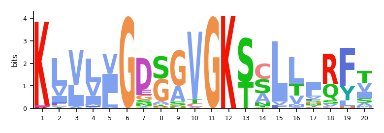
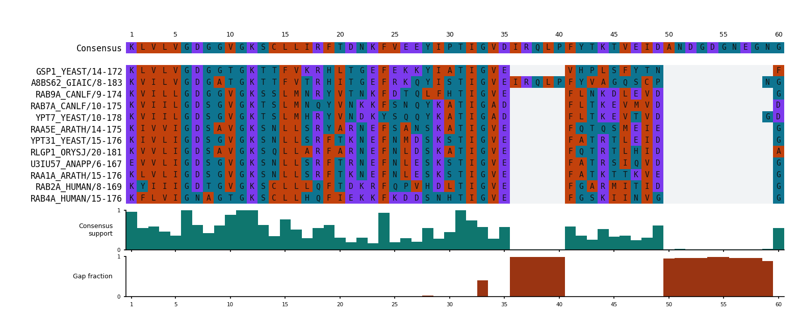

<!-- Generated by docs/tutorials/build.py from _src/04_protein_family_figures.md; edit the template. -->

# 4. Protein families and publication figures

**You will:** score conservation with BLOSUM62, relate it to physicochemical
variability, and draw residue-level alignment figures and sequence logos in vector
formats ready for a manuscript.

**Data:** the Ras-family seed alignment (Pfam PF00071).

## Substitution-matrix conservation

For proteins, MSATK scores each column by the mean BLOSUM62 score over all pairs of
residues in it. This rewards conservative substitutions such as I↔L, which plain identity
does not.

```python
from msatk import MSATK, datasets

ras = MSATK(datasets.path("ras_pf00071"), pairwise="none")
summaries, tables, why = ras.specialized()
print(summaries["substitution"])

scores = {r["site_index"]: r["mean_blosum62"] for r in tables["site_substitution_scores"]}
print("P-loop sites 6-13:", [round(scores[i], 1) for i in range(6, 14)])
```

```text
{'mean_column_blosum62': 1.5695850619462786, 'median_column_blosum62': 1.23954802259887, 'columns_scored_blosum62': 196}
P-loop sites 6-13: [6.0, 2.5, 1.6, 2.4, 3.0, 6.0, 5.0, 2.7]
```

## Physicochemical variability

The physicochemical encoding gives each residue its Kyte–Doolittle hydropathy, charge,
volume, polarity and aromaticity. The spread of hydropathy within a column shows whether
substitutions there keep the residue's character.

```python
import numpy as np

pc = ras.to_tensor("physicochemical")
print(pc.array.shape, pc.channels)

residue = (pc.array[:, :, 5] == 0) & (pc.array[:, :, 6] == 0)      # not gap, not missing
hydropathy = np.where(residue, pc.array[:, :, 0] * 4.5, np.nan)      # back to the KD scale
sd = np.nanstd(hydropathy, axis=0)
filled = residue.mean(axis=0) >= 0.5
print("median hydropathy SD, P-loop (6-13):", round(float(np.median(sd[5:13])), 2))
print("median hydropathy SD, other filled columns:",
      round(float(np.nanmedian(np.delete(sd[filled], range(5, 13)))), 2))
```

```text
(60, 229, 7) ['hydropathy_kd', 'charge', 'volume', 'polar', 'aromatic', '<gap>', '<non_residue>']
median hydropathy SD, P-loop (6-13): 0.48
median hydropathy SD, other filled columns: 1.74
```

## Residue-level alignment figure

`plot_alignment` draws a region of the alignment with a consensus row and statistic
tracks. The file extension sets the format: PNG, SVG, PDF or TIFF.

```python
ras.plot_alignment("ras_region.png", start=1, end=60, max_rows=20,
                   order="consensus_identity", tracks=("conservation", "gaps"), dpi=150)
ras.plot_alignment("ras_region.pdf", start=1, end=60, max_rows=20,
                   order="consensus_identity")                         # vector, for print
```



With `highlight_differences=True`, residues that match the consensus are greyed out so
substitutions stand out:

```python
ras.plot_alignment("ras_diff.png", start=1, end=60, max_rows=20,
                   order="consensus_identity", highlight_differences=True, dpi=150)
```



## Sequence logos

Logos use information content with a small-sample correction (Schneider et al. 1986).

```python
ras.plot_logo("ploop_logo.png", start=1, end=20, dpi=150)
ras.plot_logo("ploop_logo.svg", start=1, end=20)
```



## Colour themes

The built-in themes are `nucleotide`, `protein`, `nucleotide_cvd` (safe for colour-vision
deficiency) and `grayscale`. You can also pass a dictionary or a JSON or YAML file that
maps residues to colours. Residues the theme does not list fall back to a neutral colour.

```python
hydrophobic = {aa: "#c2410c" for aa in "AVILMFWC"}
polar = {aa: "#0e7490" for aa in "STNQGPHY"}
charged = {aa: "#7c3aed" for aa in "DEKR"}
ras.plot_alignment("ras_custom.png", start=1, end=60, max_rows=12, dpi=150,
                   theme={**hydrophobic, **polar, **charged})
```



From the command line:

```bash
msatk datasets ras_pf00071 --out data
msatk plot data/ras_pf00071.sto.gz --start 1 --end 60 --theme grayscale --out region.pdf
msatk logo data/ras_pf00071.sto.gz --start 1 --end 20 --out logo.svg
```

```text
data/ras_pf00071.sto.gz
MSATK alignment figure written: region.pdf
MSATK sequence logo written: logo.svg
```
