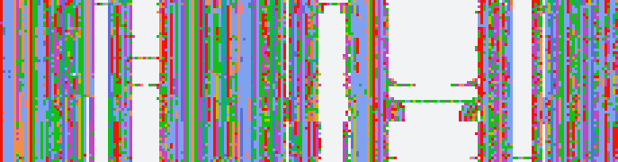

<!-- Generated by docs/tutorials/build.py from _src/05_ml_encodings.md; edit the template. -->

# 5. Machine-learning representations

**You will:** turn an alignment into tensors, check that the encoding loses nothing,
handle ambiguity codes deliberately, cut fixed-size windows that keep their original
coordinates, save everything with a manifest, and feed it to a PyTorch `DataLoader`.

**Data:** the Ras-family seed alignment and a small nucleotide example.

MSATK keeps two kinds of output apart. **Images** (RGB) are for people to look at, and
their colours mean nothing to a model. **Encodings** (categorical, one-hot,
physicochemical, feature channels) represent the data faithfully and record exactly
what each channel means.

## Encodings

```python
from msatk import MSATK, datasets

ras = MSATK(datasets.path("ras_pf00071"), pairwise="none")
for name in ["categorical", "onehot", "physicochemical", "features"]:
    t = ras.to_tensor(name)
    print(f"{name:16} shape {str(t.array.shape):16} dtype {t.array.dtype}  lossless={t.lossless}")
print(ras.to_tensor("onehot").channels)
```

```text
categorical      shape (60, 229)        dtype uint8  lossless=True
onehot           shape (60, 229, 22)    dtype float32  lossless=False
physicochemical  shape (60, 229, 7)     dtype float32  lossless=False
features         shape (60, 229, 7)     dtype float32  lossless=False
['A', 'C', 'D', 'E', 'F', 'G', 'H', 'I', 'K', 'L', 'M', 'N', 'P', 'Q', 'R', 'S', 'T', 'V', 'W', 'Y', '<gap>', '<missing>']
```

The one-hot encoding has 20 amino-acid channels plus explicit `<gap>` and `<missing>`
channels, so a gap is not confused with "nothing observed".

## The categorical encoding is exactly reversible

```python
from msatk.encoding.tensors import decode_categorical
from msatk.encoding.vocab import full_vocabulary

cat = ras.to_tensor("categorical")
back = decode_categorical(cat.array, cat.ids, full_vocabulary("protein"))
original = [r.sequence.upper() for r in ras.alignment.records]
print("round trip identical:", [r.sequence for r in back.records] == original)
```

```text
round trip identical: True
```

## Choosing how ambiguity codes are encoded

IUPAC codes such as `R` (A or G) or `N` (any base) can be encoded in three ways:

```python
from msatk.encoding.tensors import onehot
from msatk.models import Alignment, SequenceRecord

dna = Alignment((SequenceRecord("s1", "ACGRN-"),))
for policy in ["missing", "fractional", "separate"]:
    t = onehot(dna, "dna", ambiguity=policy)
    print(policy, t.channels)
    for ch, row in zip("ACGRN-", t.array[0]):
        print(f"   {ch}: {[round(float(v), 2) for v in row]}")
```

```text
missing ['A', 'C', 'G', 'T', '<gap>', '<missing>']
   A: [1.0, 0.0, 0.0, 0.0, 0.0, 0.0]
   C: [0.0, 1.0, 0.0, 0.0, 0.0, 0.0]
   G: [0.0, 0.0, 1.0, 0.0, 0.0, 0.0]
   R: [0.0, 0.0, 0.0, 0.0, 0.0, 1.0]
   N: [0.0, 0.0, 0.0, 0.0, 0.0, 1.0]
   -: [0.0, 0.0, 0.0, 0.0, 1.0, 0.0]
fractional ['A', 'C', 'G', 'T', '<gap>', '<missing>']
   A: [1.0, 0.0, 0.0, 0.0, 0.0, 0.0]
   C: [0.0, 1.0, 0.0, 0.0, 0.0, 0.0]
   G: [0.0, 0.0, 1.0, 0.0, 0.0, 0.0]
   R: [0.5, 0.0, 0.5, 0.0, 0.0, 0.0]
   N: [0.25, 0.25, 0.25, 0.25, 0.0, 0.0]
   -: [0.0, 0.0, 0.0, 0.0, 1.0, 0.0]
separate ['A', 'C', 'G', 'T', '<gap>', '<ambiguous>', '<missing>']
   A: [1.0, 0.0, 0.0, 0.0, 0.0, 0.0, 0.0]
   C: [0.0, 1.0, 0.0, 0.0, 0.0, 0.0, 0.0]
   G: [0.0, 0.0, 1.0, 0.0, 0.0, 0.0, 0.0]
   R: [0.0, 0.0, 0.0, 0.0, 0.0, 1.0, 0.0]
   N: [0.0, 0.0, 0.0, 0.0, 0.0, 0.0, 1.0]
   -: [0.0, 0.0, 0.0, 0.0, 1.0, 0.0, 0.0]
```

With `fractional`, `R` becomes half A and half G, and `N` is spread evenly over the
four bases. With `separate`, ambiguity codes get their own channel. Every cell sums to 1
under all three policies.

## Fixed-size windows that keep their coordinates

Biological alignments must not be resized, rotated or interpolated like photographs.
MSATK instead cuts them into whole-cell windows, pads the last window, and records
where each window came from.

```python
export = ras.export_encoding("ml", encoding="onehot", window=64, stride=32,
                             rows_per_tile=32, stem="ras")
import json
manifest = json.loads(open("ml/ras_onehot.manifest.json").read())
print("shape:", manifest["shape"], "axes:", manifest["axes"])
print("lossless:", manifest["lossless"], "| ambiguity:", manifest["encoding_details"]["ambiguity_policy"])
for tile in manifest["windowing"]["tiles"][5:8]:
    print(tile)
```

```text
shape: [14, 32, 64, 22] axes: ['tile', 'sequence', 'site', 'channel']
lossless: False | ambiguity: missing
{'tile': 5, 'row_start': 0, 'row_end': 31, 'site_start': 161, 'site_end': 224, 'valid_rows': 32, 'valid_sites': 64}
{'tile': 6, 'row_start': 0, 'row_end': 31, 'site_start': 193, 'site_end': 229, 'valid_rows': 32, 'valid_sites': 37}
{'tile': 7, 'row_start': 32, 'row_end': 59, 'site_start': 1, 'site_end': 64, 'valid_rows': 28, 'valid_sites': 64}
```

The NPZ file holds `x` (the tiles), `mask` (True for real cells, False for padding) and
`tiles` (the original row and site range of each tile). The manifest also records the
input SHA-256, the vocabulary and the transforms applied.

## Feeding a model

`AlignmentTensorDataset` returns NumPy arrays, so it works with any framework:

```python
import torch
from torch.utils.data import DataLoader
from msatk.ml.datasets import AlignmentTensorDataset, to_torch

ds = AlignmentTensorDataset("ml/ras_onehot.npz", channels_first=True)
loader = DataLoader(ds, batch_size=4, shuffle=False,
                    collate_fn=lambda b: {k: torch.stack([to_torch(i[k]) for i in b]) for k in b[0]})
batch = next(iter(loader))
print({k: tuple(v.shape) for k, v in batch.items()})
print("padding cells in first batch:", int((~batch["mask"]).sum()))
```

```text
{'x': (4, 22, 32, 64), 'mask': (4, 32, 64), 'tile': (4, 4)}
padding cells in first batch: 0
```

## Images

RGB images are for display. Label images store vocabulary indices and are lossless.
Enlarging an image by a whole-number factor is exact; shrinking it loses information.

```python
for kind, scale in [("rgb", 3), ("label", 1)]:
    info = ras.to_image(f"ras_{kind}.png", kind=kind, scale=scale)
    meta = json.loads(open(info["manifest"]).read())
    print(kind, "shape", meta["image_shape"], "pixels per cell", meta["cell_pixels"],
          "lossless", meta["lossless"])
```

```text
rgb shape [180, 687, 3] pixels per cell 3 lossless True
label shape [60, 229] pixels per cell 1 lossless True
```



## From the command line

```bash
msatk datasets ras_pf00071 --out data
msatk encode data/ras_pf00071.sto.gz --encoding onehot --window 64 --stride 32 --out ml_cli
msatk image data/ras_pf00071.sto.gz --kind label --out labels.png
```

```text
data/ras_pf00071.sto.gz
MSATK tensor written: ml_cli/alignment_onehot.npz shape=(7, 60, 64, 22)
Manifest: ml_cli/alignment_onehot.manifest.json
MSATK image written: labels.png shape=(60, 229)
```
