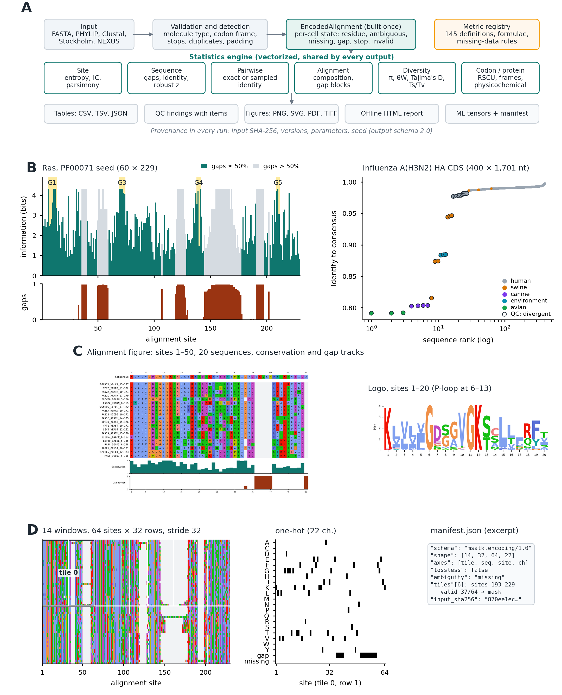

<!--
DRAFT — Bioinformatics Application Note (target ≤ 2,000 words + 1 figure).
All numbers are measured; regenerate with the scripts in paper/analysis/
(see paper/analysis/README.md). Supplementary material: paper/supplement.md.
Before submission: confirm the Table S2 feature entries against current releases
of the compared tools, and add AliStat to Table 2 if it can be run.
-->

# Abstract

<!-- ~150 words -->

**Summary:** Multiple sequence alignments (MSAs) underpin phylogenetics, molecular
evolution and protein-family analysis, yet the checks applied to them before
downstream inference are usually ad hoc scripts whose treatment of gaps, missing
data and ambiguity is undocumented. MSATK is a Python toolkit and command-line
application that turns an existing alignment into explicitly defined statistics at
alignment, sequence, site and pair resolution, severity-ranked quality-control
findings, publication-quality figures, an interactive offline HTML report, and
reproducible numerical and image representations for machine learning. All metrics
share one molecule-aware character policy, undefined quantities are reported as
missing rather than zero, and every output field is defined in a versioned metric
dictionary. On public protein-family and viral alignments, shared metrics agree
exactly with AMAS, and the vectorised core computes all statistics for a
5,000 × 10,000 alignment in 4.2 s. In a 400-sequence influenza haemagglutinin
dataset, MSATK's quality-control rules flagged 16 of 20 non-human-host sequences,
whose removal halved estimated nucleotide diversity.

**Availability and implementation:** MSATK is implemented in Python (≥ 3.10) and
released under the MIT licence at https://github.com/aglucaci/MSATK, with
documentation, tests and benchmarks. Version 0.2.0 is described.

# 1 Introduction

<!-- ~300 words -->

Before an MSA is used for tree inference, selection analysis or model training,
analysts need to know how complete it is, where gaps and ambiguity concentrate,
how conserved and informative its columns are, and which sequences are outliers.
Existing tools address parts of this problem: AMAS computes summary statistics and
manipulates alignments [@borowiec2016amas], AliStat reports completeness
[@wong2020alistat], trimAl filters columns [@capella2009trimal], CIAlign cleans and
visualises alignments [@tumescheit2022cialign], and Jalview and AliView support
interactive inspection [@waterhouse2009jalview; @larsson2014aliview].

Three gaps remain. First, conventions are implicit: whether an all-gap column
counts as conserved, whether non-overlapping sequences have identity zero or no
identity, and whether `N` is missing data (DNA) or asparagine (protein) differ
between scripts and change results. Second, statistics, figures and reports are
produced by separate tools with separate parsers. Third, ML studies that encode
alignments as tensors re-implement encodings without recording vocabulary, channel
semantics or coordinate provenance.

MSATK addresses these with a single analysis engine whose conventions are explicit,
tested and exported alongside every result.

# 2 Implementation

<!-- ~450 words -->

MSATK reads FASTA/A3M, PHYLIP, CLUSTAL, Stockholm, NEXUS, MAF and SAM (BAM/CRAM via
pysam [@pysam]) and detects molecule type. The alignment is vectorised once into
three N × L arrays — normalised characters, cell state and canonical-residue index —
under a molecule-specific policy that assigns each cell to *residue*, *ambiguous*,
*missing*, *gap* or *stop*. Unequal-length input is padded with missing data, never
with gaps, and the padding is reported.

All statistics are NumPy [@harris2020numpy] array operations on this shared
encoding. Column-level counts drive entropy [@shannon1948], information content,
conservation, parsimony-informative and singleton classification; columns without
residues are classified as *unobserved* and receive null statistics. Sequence-level
statistics include gap-run structure, spans, ambiguity, composition, identity to
the majority consensus and composition distance, with robust (median/MAD) z-scores
for outlier detection that avoid the O(N²) cost of pairwise comparison.

Pairwise identity is computed over mutually comparable sites as Σ_c X_c X_cᵀ over
one-hot indicator matrices in row blocks. A size-aware policy chooses exact
comparison up to 1,000 sequences and a seeded sample of pairs above that; the method
and seed are recorded. For nucleotide alignments, MSATK computes segregating sites,
nucleotide diversity [@nei1979], Watterson's θ [@watterson1975], Tajima's D
[@tajima1989], haplotype diversity and pooled Ts/Tv on complete sites.

Each statistic is registered with its resolution, formula, denominator,
missing-data policy, range, applicability and the condition under which it is
undefined; the registry is written as `metric_dictionary.json` with every run.
Provenance (input SHA-256, version, parameters, seed, dependency versions,
coordinate convention) is written to `summary.json`, `parameters.yaml` and
`run_manifest.json`.

The CLI (`msatk profile|stats|qc|plot|logo|encode|image|...`) and the Python API
(`AlignmentProfiler.summary()`, `.sites()`, `.sequences()`, `.pairwise()`, `.qc()`,
`.plot_alignment()`, `.to_tensor()`, `.report()`) call the same cached engine.

# 3 Functionality

<!-- ~450 words -->

**Quality control.** Sixteen explicit rules produce findings with a code,
severity, explanation, suggested action and the affected sequences or sites (e.g.
high-gap rows or columns, divergent or compositionally atypical sequences,
non-overlapping pairs, internal stop codons, partially gapped codons).

**Codon and protein modules.** Codon alignments add codon usage, RSCU
[@sharp1986rscu], GC1/GC2/GC3, codon-position entropy and stop-codon reports;
protein alignments add amino-acid and residue-class composition and Kyte–Doolittle
hydropathy [@kyte1982hydropathy].

**Visualization.** Residue-level alignment figures show a region with consensus row,
conservation/entropy/gap tracks, row ordering and difference highlighting; sequence
logos use the small-sample-corrected information content [@schneider1986]. Themes
(including a colour-vision-deficiency-safe palette) are configurable via JSON/YAML,
and figures are written as PNG, SVG, PDF or TIFF via Matplotlib [@hunter2007matplotlib].

**Interactive report.** `report.html` requires no server or network access. It
embeds the data as JSON and provides a canvas residue viewer (scroll, zoom, ID
search, jump-to-site, colouring by residue or difference from consensus), clickable
site tracks, sortable and filterable tables with CSV export, a pairwise heatmap,
QC findings, provenance and the metric dictionary; a single-file mode embeds figures.

**ML representations.** MSATK keeps human-facing RGB images separate from faithful
encodings: a categorical encoding over a full IUPAC/amino-acid vocabulary that is
exactly reversible; one-hot channels with explicit gap and missing channels and a
choice of ambiguity policy (missing, fractional IUPAC expansion, or separate
channel); physicochemical channels for proteins [@kyte1982hydropathy;
@zamyatnin1972]; and per-cell QC feature channels. Instead of resizing, alignments
are cut into integer-exact windows with padding masks and per-tile original
coordinates. Every export carries a manifest, and a framework-agnostic dataset class
feeds PyTorch [@paszke2019pytorch] or TensorFlow directly. Table 1 summarises the
outputs by resolution.

**Table 1.** MSATK outputs by resolution. All fields are defined in the metric
dictionary (145 entries in v0.2.0); "–" marks statistics that are undefined and
reported as null rather than zero.

| Resolution | Main outputs | Undefined (null) when |
|---|---|---|
| Alignment (81) | size, occupancy, gap/missing/ambiguous fractions; constant, variable, parsimony-informative, singleton, gap-free and complete sites; mean entropy; mean/min/max pairwise identity; π, θW, Tajima's D, haplotype count and diversity, Ts/Tv (nucleotides) | N < 2 or no complete site (π, θW); N < 4 or S = 0 (Tajima's D); no transversions (Ts/Tv); no comparable pair (identity) |
| Site (23) | site class, occupancy, gap fraction, dominant residue and support, Shannon entropy, normalised entropy, effective states, information content, parsimony class; codon position (codon), GC (nucleotides) | column has no canonical residue ("unobserved") |
| Sequence (35) | original/ungapped length, span, leading/trailing/internal gaps, gap runs, ambiguity, composition and composition distance, identity to consensus, nearest neighbour, duplicate-of, robust z-scores, outlier score | all-gap row (span); no comparable column (consensus identity) |
| Pair (6) | identity, p-distance, comparable sites, overlap; exact or seeded-sample policy recorded | pair shares no comparable site |
| QC | 16 rules; findings with code, severity, scope, message, suggestion and affected IDs/sites | – |
| Figures | alignment overview, per-site tracks, residue-level alignment, sequence logo, identity heatmap, embeddings; PNG/SVG/PDF/TIFF | – |
| ML | categorical (lossless), one-hot (3 ambiguity policies), physicochemical (7 ch.), QC feature channels (7 ch.), windows with masks, RGB and label images; NPZ + manifest | – |

# 4 Results

<!-- ~600 words; analyses reproducible with paper/analysis/*.py -->

**Correctness.** The test suite (97 tests) checks hand-calculated values for edge
cases including all-gap columns, non-overlapping pairs, padding, molecule-specific
interpretation of `N`, entropy bounds, parsimony and singleton definitions and gap
runs. Nucleotide diversity, Watterson's θ and Tajima's D agree with scikit-allel
[@miles2023allel] to floating-point precision on simulated populations. Categorical
encodings reconstruct the input exactly, and one-hot cells sum to one under every
ambiguity policy.

**Agreement and runtime versus AMAS.** We compared MSATK with AMAS v1.0
[@borowiec2016amas] on four Pfam seed alignments [@mistry2021pfam], 400 influenza
haemagglutinin coding sequences from GenBank [@sayers2023genbank] and two synthetic
DNA alignments (Table 2; Supplementary Table S1). Number of sequences, length,
missing-data percentage, variable sites and parsimony-informative sites were
identical for all seven alignments, including the 22 IUPAC-ambiguous cells in the
influenza data. Including interpreter start-up, MSATK was 2.4–2.9× faster than AMAS
on 10⁷–5 × 10⁷-cell alignments while also computing per-site, per-sequence and
population-genetic statistics; on alignments of a few thousand cells, AMAS was
faster (0.03 s versus 0.13 s) because MSATK's start-up dominates. A feature
comparison with AliStat, CIAlign, trimAl and Jalview is given in Supplementary
Table S2. On a 5,000 × 10,000 alignment, exact all-vs-all identity
(12.5 million pairs) added about 4 s to the statistics run, and the default sampled
policy added 0.3 s (`docs/benchmarks.md`).

**Table 2.** Shared metrics and runtime, MSATK v0.2.0 versus AMAS v1.0 (Apple M1 Pro,
median of three runs, each a fresh process). Var., variable sites; PI,
parsimony-informative sites. Missing (%) counts gaps and missing-data symbols.

| Alignment | N × L | Missing (%) | Var. | PI | Agree | AMAS (s) | MSATK (s) |
|---|---|---|---|---|---|---|---|
| PF00042 globin | 73 × 141 | 18.88 | 134 | 119 | yes | 0.03 | 0.13 |
| PF00069 protein kinase | 37 × 419 | 36.14 | 374 | 271 | yes | 0.03 | 0.13 |
| PF00071 Ras | 60 × 229 | 27.72 | 184 | 160 | yes | 0.03 | 0.12 |
| PF00076 RRM | 68 × 79 | 12.10 | 77 | 71 | yes | 0.03 | 0.13 |
| Influenza H3N2 HA (CDS) | 400 × 1,701 | 0.00 | 789 | 666 | yes | 0.17 | 0.19 |
| Synthetic DNA | 1,000 × 10,000 | 0.50 | 10,000 | 10,000 | yes | 2.53 | 1.04 |
| Synthetic DNA | 5,000 × 10,000 | 0.50 | 10,000 | 10,000 | yes | 12.34 | 4.20 |

**Use case 1: QC of a viral coding alignment before selection analysis.** We
retrieved the haemagglutinin CDS of 400 GenBank records annotated as influenza
A(H3N2) (publication year 2017); all were 1,701 nt and formed an ungapped codon
alignment. `msatk profile --type codon --preset comprehensive` completed in 8.7 s.
Frame checks found a terminal stop codon in every sequence, no internal stops and
no frame warnings. Mean entropy at third codon positions (0.142 bits) was 3.4–3.7
times that at first and second positions (0.042 and 0.038), as expected for
predominantly synonymous variation. QC reported 134 sequences identical to an
earlier one and flagged 27 as divergent from the consensus (Fig. 1B). Host labels
parsed from the record titles showed that the divergent set contained all four
canine, three avian and three environmental sequences and six of ten swine
sequences (16 of 20 non-human-host sequences; identity to consensus 0.79–0.95,
versus ≥ 0.985 for every unflagged sequence). The four unflagged swine sequences
were human-like (identity to consensus ≥ 0.986; one had a human strain as nearest
neighbour at 99.94% identity). The remaining 11 flagged sequences were human
strains at the low tail of the human distribution (0.977–0.981). Removing the 27
flagged sequences halved nucleotide diversity (π from 0.0233 to 0.0119) and
Watterson's θ (0.070 to 0.035), and reduced the segregating sites from 789 to 387,
whereas Tajima's D changed little (−2.05 to −2.01). Mixed-host data of this kind
would otherwise inflate diversity-dependent estimates, such as those used in
selection analyses [@pond2020hyphy].

**Use case 2: a protein family from statistics to tensors.** For the Ras family
seed alignment (PF00071; 60 × 229, 27.7% gaps, mean pairwise identity 0.38), QC
flagged 67 columns with more than 50% gaps; all 67 are insert-state columns
(marked `.` in the Pfam alignment). Among the 162 columns with at most 50% gaps, four guanine-nucleotide-binding
motifs [@bourne1991gtpase], located in the alignment by searching a reference
sequence (RAS2_YEAST), had mean information content of 3.39–4.25 bits, compared
with a median of 1.96 bits for the other occupied columns. Thirteen of the 21 motif
columns were among the 20 most informative occupied columns. Physicochemical
encoding showed the same constraint: the median per-column standard deviation of
Kyte–Doolittle hydropathy was 0.01 in motif columns and 1.79 elsewhere. MSATK
rendered the region as a residue-level figure with tracks and a sequence logo
(Fig. 1C). A one-hot export cut into 64-site × 32-row windows (stride 32) produced
14 tiles with padding masks and per-tile coordinates in 15 ms, and these loaded
directly into a PyTorch `DataLoader` as tensors of shape 8 × 22 × 32 × 64 (Fig. 1D).

**Figure 1.** MSATK architecture and outputs generated from real data.
(**A**) One molecule-aware encoding of the alignment feeds all statistics, QC,
figures, the report and ML exports, each carrying provenance. (**B**) Left: per-site
information content (top) and gap fraction (bottom) for the Ras family (PF00071);
shaded bands mark the G1, G3, G4 and G5 motifs and grey bars mark columns with more
than 50% gaps. Right: identity to consensus for 400 influenza H3N2 haemagglutinin
sequences, coloured by host label from GenBank titles; outlined points were flagged
DIVERGENT_SEQUENCES by QC. (**C**) Residue-level alignment figure for Ras sites 1–50
(20 sequences ordered by identity to consensus) with conservation and gap tracks,
and a small-sample-corrected logo of sites 1–20 showing the P-loop (GxxxxGK[ST]).
(**D**) RGB rendering of the full Ras alignment (display only) with the 64 × 32
window grid; one-hot channels for one row of tile 0; and an excerpt of the manifest
that records shape, axes, ambiguity policy, padding masks and original coordinates
for each tile. All panels are produced by `paper/analysis/make_figure1.py`.

# 5 Discussion

<!-- ~150 words -->

MSATK's contribution is not any single statistic but a reproducible
alignment-to-analysis layer in which conventions are explicit, outputs are defined
and machine-readable, and the same engine drives statistics, figures, reports and
ML encodings. MSATK does not build, trim or edit alignments, and it does not perform
model-based evolutionary inference; it complements aligners, trimmers and
phylogenetic software. Population-genetic statistics assume homologous population
samples and use complete sites only, and per-site information content is computed
over observed residues, so sparsely occupied columns should be read together with
their occupancy (Fig. 1B). The interactive viewer is limited to alignments
of up to three million cells, and alignments much larger than memory require
streaming, which is planned together with coevolution statistics and alternative
genetic codes.

# Availability and implementation

MSATK v0.2.0 is available at https://github.com/aglucaci/MSATK under the MIT licence
and installable with `pip install msatk`; documentation, the metric dictionary,
tests and the benchmark harness are included in the repository.

# Funding

No external funding was received for this work unless otherwise specified by the author.

# Conflict of Interest

The author declares no competing interests.

# References
